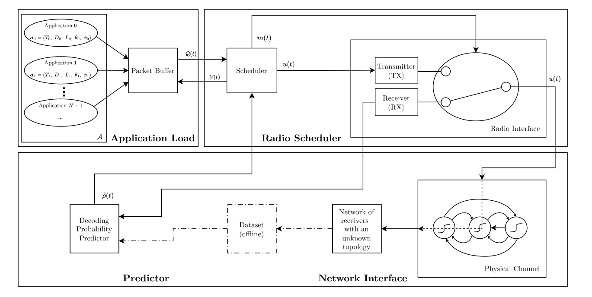
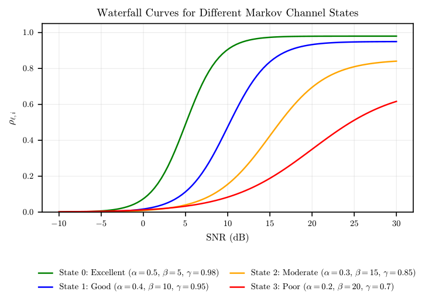
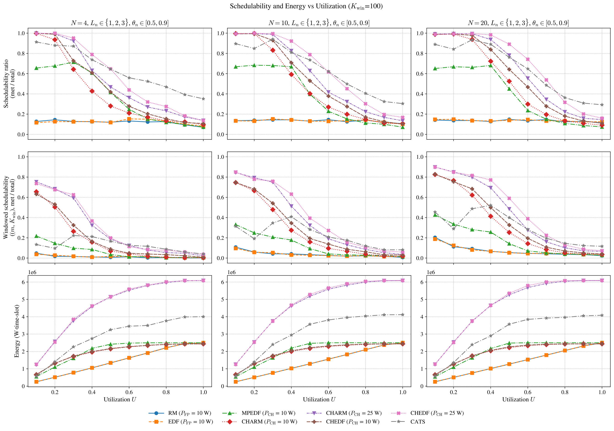

# rt-link-sim

[](https://zenodo.org/badge/latestdoi/1058596420)

Real-time scheduling over an unreliable link. A C++ simulator for wireless packet scheduling under deadline and channel-quality constraints, driven by a Python experiment harness.

It models the whole path from application load to decoded frame: periodic tasks with deadlines and reliability requirements, a packet buffer, a scheduler choosing when to transmit and at what power, a radio interface, a finite-state Markov channel, and a decode-probability predictor. Each piece is replaceable.

**Full documentation: [doc/USAGE.md](doc/USAGE.md)**

## Features

- **Pluggable channel.** A channel is two data files, a transition matrix and one decode curve per state. Any Markov chain and any set of curves can be dropped in. A second channel type replays per-tick outcomes recorded from measured data.
- **Pluggable scheduling policy.** A scheduler is a subclass of one interface. Seven ship with the simulator.
- **Generated or hand-written task sets.** The harness draws task sets with UUniFast from a target utilization, or a config can specify packets directly.
- **Reproducible.** One master seed fixes the task sets and every random stream in the C++ side, so a run reproduces bit-identical figures.
- **Sweeps and figures out of the box.** Schedulability, weakly-hard schedulability and energy against utilization, parallelised across cores and ready to submit to a SLURM cluster.

## System model



The simulator reproduces the system model from that diagram, one directory per block:

| Block in the figure | Symbol | Where it lives |
|---|---|---|
| Application load | $`a_n = (T_n, D_n, L_n, \theta_n, \varphi_n)`$ | `packet_generators/fixed_rate/` |
| Packet buffer | $`\mathcal{Q}(t)`$, $`\mathcal{V}(t)`$ | `system_model/buffer_packet/` |
| Scheduler | $`u(t)`$, $`m(t)`$ | `schedulers/` |
| Radio interface | TX, RX | `system_model/radio_interface/`, `system_model/target_receiver/` |
| Physical channel | | `physical_channels/sigmoid_channel/` |
| Decoding probability predictor | $`{\hat{\rho}(t)}`$ | `system_model/ml_predictor/` |

A simulation advances one frame (time-slot) per tick. On every tick the generators release packets into the buffer, the predictor reports a decode probability per power level, the scheduler picks one buffered packet and a power or else idles or listens, the channel draws the outcome, and the buffer discards anything whose deadline has passed. A packet needs `frames` successful slots before its deadline to count as delivered.

The dashed path through the offline dataset is the replay experiment. The solid path is the synthetic channel used by every sweep.

## Channel model

The physical channel is a finite-state Markov chain. Each state carries a sigmoid decode curve giving the probability of decoding a frame at a given SNR:

```math
\rho_s(\mathrm{SNR}) = \frac{\gamma_s}{1 + \exp\!\left(-\alpha_s \left(\mathrm{SNR} - \beta_s\right)\right)}
```

Both the chain and the curves are data rather than code, so a different channel is a different pair of files. The example shipped in `physical_channels/channel_20m/` is a 6-state ring carrying three distinct curves, mirrored so the walk descends from Good to Poor and climbs back:



The figure plots a family of four example parameterisations; the shipped example instantiates the lower three. Details, including how to supply your own, are in [doc/USAGE.md](doc/USAGE.md#channel-model).

## Schedulers

Seven scheduler types ship with the simulator, spanning a ladder of channel knowledge crossed with the two queue disciplines:

| | Period-ordered | Deadline-ordered |
|---|---|---|
| No channel knowledge | RM | EDF |
| Long-run channel average | MPRM | MPEDF |
| Refreshed channel estimate | CHARM | CHEDF |
| Belief-driven, adaptive power | | CATS |

Rate-Monotonic (RM) and Earliest-Deadline-First (EDF) are the classical fixed-power baselines. The other five all allocate redundancy from an estimate of the decode probability, and differ in where that estimate comes from: a single long-run mean fixed before the run starts (MPRM and MPEDF, the closest of the five to the mean-predictor schedulers in the literature), an estimate refreshed by listening to the channel (CHARM and CHEDF), or a belief about the current channel state paired with a utilization test that chooses both when to transmit and at what power (CATS, Channel-Adaptive Transmission Scheduler). All seven are implemented in this project against the same interface, so none of them is privileged by the harness.

Each row of the table is one policy over both queue disciplines, so a pair such as CHARM/CHEDF isolates the queue discipline while a column isolates channel knowledge.

Parameters, policy details and how to add a new scheduler are documented in [doc/USAGE.md](doc/USAGE.md#schedulers).

## Results

The `sweep` mode produces the main comparison figure: three scenarios across the columns, three metrics down the rows.



Every point averages 200 independently drawn task sets, each simulated for 250,000 time-slots, which is 48,000 simulations for the figure as a whole. At that length the metrics have converged and the run-to-run spread is under 1%, so a gap between two curves is the scheduling policy rather than sampling noise. A figure of this size is what [`run_slurm.sh`](#publication-scale-runs) exists for.

These curves are a property of the example channel as much as of the schedulers. A different chain or different decode curves would move them.

## Quick start

```bash
make                                      # builds ./main.o
./main.o                                  # one run from simulation_config.json
SEED=42 python run_simulation.py 1 sweep my-run   # a full sweep and its figures
```

Outputs land under `tests/my-run/`. See [doc/USAGE.md](doc/USAGE.md) for prerequisites, the config format, the other sweep modes, metrics and how to extend the simulator.

### Publication-scale runs

A full sweep is tens of thousands of simulations, which is more than a workstation should be asked for. `run_slurm.sh` is a template for submitting the harness to a SLURM cluster: the resource requests, module loads, conda activation, mode validation and argument forwarding are all in place, with resource-sizing estimates in the comments. It ships configured for AIRE at Leeds, so the notification address, the `module load` lines, the conda environment name and the `#SBATCH` sizing are the parts to point at your own cluster; the rest runs unchanged.

```bash
make                                        # build on a login node first
sbatch --export=N_RUNS=200,MODE=sweep,ALL run_slurm.sh my-run
```

[doc/SLURM.md](doc/SLURM.md) covers submission, monitoring, post-mortem and how to size the resource requests, including the traps that have cost whole jobs.

## Credits

- **[nlohmann/json](https://github.com/nlohmann/json)** by Niels Lohmann, JSON for Modern C++ (MIT License)
- **[kovian](https://github.com/RubyGB/kovian)**, a single-header library for finite state space Markov chain simulations

## License

See [LICENSE](LICENSE) for details.

## Contributing

Active work happens on `dev`, and pull requests land on `main`. Please keep to the existing style conventions and do not introduce new static-analysis warnings.
