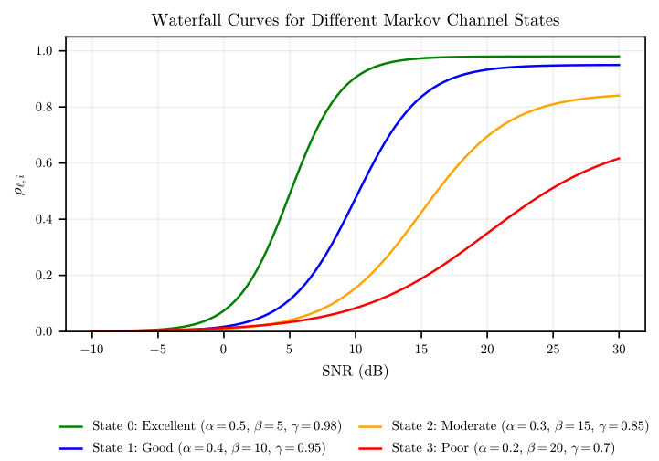

# rt-link-sim usage

Full documentation for building, configuring, running and extending the
simulator. For a short overview of what it models, see the
[README](../README.md).

## Contents

- [Build](#build)
- [Running a single simulation](#running-a-single-simulation)
- [Config format](#config-format)
- [Schedulers](#schedulers)
- [Channel model](#channel-model)
- [Running the experiment harness](#running-the-experiment-harness)
- [Replay experiment](#replay-experiment)
- [Cluster runs](#cluster-runs)
- [Metrics](#metrics)
- [Reproducibility](#reproducibility)
- [Outputs](#outputs)
- [Project structure](#project-structure)
- [Extending the simulator](#extending-the-simulator)
- [Code quality](#code-quality)

Cluster submission and monitoring recipes live in a separate reference,
[SLURM.md](SLURM.md).

## Build

```bash
make            # produces the executable ./main.o
make clean
```

The top-level Makefile recurses into `system_model/`, `packet_generators/`,
`schedulers/` and `physical_channels/`, compiles each component into an object
file in the repository root, then links everything into `main.o`.

**Prerequisites**

- `g++` with C++17 support (the code uses `std::optional`)
- `make`
- Python 3.8 or newer with `matplotlib`, for the harness and the plots
- [nlohmann/json](https://github.com/nlohmann/json) and
  [kovian](https://github.com/RubyGB/kovian), both vendored in `libs/`

Header dependencies are not tracked by the Makefile, so run `make clean` before
`make` after editing a header. After any C++ edit, rebuild before running the
Python harness.

## Running a single simulation

```bash
./main.o [config_file] [log_file] [summary]
```

Defaults are `simulation_config.json` for the config and `simulation_log.json`
for the log. Passing `summary` as the third argument silences stdout, skips the
per-frame JSON log and writes only a small aggregate, which is what the harness
uses. Note that `summary` is positional, not a flag: `--summary` would be read
as the config path.

## Config format

`simulation_config.json` has four sections:

```json
{
    "simulation": {
        "duration": 1500,
        "predict_error": 0.0,
        "window_k": 100,
        "seed": 42
    },
    "scheduler": {
        "type": "CATS",
        "channel": 0,
        "belief_threshold": 0.7,
        "utilization_threshold": 0.9
    },
    "channels": [
        { "type": "sigmoid", "name": "cyclic_fast_6" }
    ],
    "packet_generators": [
        {
            "type": "fixed_rate",
            "packets": [
                {
                    "id": 1,
                    "relative_deadline": 24,
                    "frames": 1,
                    "reliability": 0.56,
                    "period": 24,
                    "phase": 0
                }
            ]
        }
    ]
}
```

- `simulation`: `duration` in frames, plus the optional `seed`,
  `predict_error` and `window_k`. `predict_error` is the half-width of the
  uniform noise injected into each predicted decode probability, and applies
  only to a channel with no fitted FSMC (`replay`): on an FSMC channel the
  predictor returns a *state label*, which has no probability to perturb.
  State-prediction error is not implemented yet, and a run that sets
  `predict_error` on the state path says so on stderr.
- `scheduler`: `type` plus the parameters listed under
  [Schedulers](#schedulers).
- `channels`: `sigmoid` takes `name`, the directory under
  `physical_channels/` to load; `replay` takes `csv_path` and an optional
  `name`. **A channel is addressed by its index, not by a frequency**: the
  channel at position `c` in this list is channel `c` everywhere else -- in a
  scheduler's `channel` field, in the per-slot log, and in a scheduler's own
  channel set. The name is descriptive only; nothing looks a channel up by it,
  and there is no `frequency` field any more.
- `packet_generators`: only `fixed_rate` is wired in. Packet fields are `id`,
  `period`, `relative_deadline`, `frames` (transmission length in slots),
  `reliability` (required reception probability) and `phase`.

The harness rewrites this file per run, so edit it only for single runs.

## Schedulers

| Type in config | Class | Parameters | Notes |
|---|---|---|---|
| `CATS` | `CATS_scheduler` | `channel`, `belief_threshold`, `utilization_threshold`, the optional switches `adaptive_power`, `early_drop`, `urgency_check` (all default true), plus `tx_power` when `adaptive_power` is false | Channel and belief aware, picks its own power |
| `CHARM` | `CHARM_scheduler` | `tx_power`, `channel`, `belief_threshold` | Accumulated-probability redundancy from a listened estimate, period-ordered queue |
| `CHEDF` | `CHEDF_scheduler` | `tx_power`, `channel`, `belief_threshold` | The same over a deadline-ordered queue |
| `MPRM` | `MPRM_scheduler` | `tx_power`, `channel` | The same redundancy rule from a static channel average, period-ordered queue |
| `MPEDF` | `MPEDF_scheduler` | `tx_power`, `channel` | The same over a deadline-ordered queue |
| `EDF` | `EDF_scheduler` | `tx_power`, `channel` | Fixed-power baseline |
| `Rate_M` | `RM_scheduler` | `tx_power`, `channel` | Fixed-power baseline |

`channel` is the index of the channel in the `channels` block, and defaults
to 0 when omitted -- which is every roster config, since the sweeps declare one
channel. A scheduler currently transmits on that one channel for the whole run;
choosing a channel per slot is what the channel set in `BaseScheduler` exists
for.

The fixed-power schedulers are normally run at both 10 W and 25 W, the two
upper tiers the predictor reports, so a scheduler that picks its own power and
one pinned to a fixed power can be read against each other at comparable
energy.

CHARM, CHEDF, MPRM and MPEDF are one redundancy rule over a 2x2. The queue is
ordered either by period or by deadline, and the decode-probability estimate
the rule consumes is either refreshed by listening to the channel (CHARM,
CHEDF) or a single long-run mean fixed before the run starts (MPRM, MPEDF).
None of the four is the origin of the others, and the mean-predictor pair is
the closer of the two to the schedulers in the literature, which generally size
redundancy from an average channel quality rather than from a live estimate.
Holding the queue order fixed isolates the estimate; holding the estimate fixed
isolates the queue discipline.

> **Note:** `CHEDF_scheduler` is a deliberate copy of `CHARM_scheduler` that
> differs only in its queue comparator, and `MPEDF_scheduler` is the same copy
> of `MPRM_scheduler`. Any change to the shared retransmission or listening
> logic has to be applied to both files of a pair, or the comparison stops
> being interpretable.

### Prediction and listening

An RX slot buys one thing: the state the channel was observed in. The predictor
returns that label, and the scheduler derives the decode probability of every
power level from it off its own copy of the channel's fitted sigmoid curves. So
one listen refreshes all power levels together, from the same state, and a
wrong label moves them all at once.

Each of CHARM, CHEDF and CATS therefore carries a copy of the fitted FSMC of
the channel it operates on, taken from the `channels` block at index
`channel`. A channel without a fitted model (`replay`)
hands over decode probabilities directly instead, as before.

All three refresh on the same rule. Confidence in the last prediction decays on
every transmitting slot and a listen restores it, so the scheduler listens once
confidence falls below `belief_threshold` rather than on a fixed interval. The
decay factor is the self-transition probability `A_ss` of the state it believes
the channel is in, so confidence after `d` slots is `A_ss^d` -- the model
probability the channel has not left that state, with `1 - A_ss` the per-slot
probability of leaving. The refresh interval is
`ceil(ln(belief_threshold) / ln(A_ss))`, which differs per channel *and* per
state: at the default threshold of 0.7 it is 18 slots everywhere on
`cyclic_fast_6`, 36 on `cyclic_slow_8`, 18 or 12 on `good_moderate_2`'s two
states, and 178, 22 or 30 on `rare_excellent_3`'s three. CATS additionally
declines to listen while a packet is on the edge of its deadline.

MPRM and MPEDF never listen, so they have no listening parameter at all.

### The mean-predictor baselines, MPRM and MPEDF

MPRM and MPEDF size their redundancy from a single number fixed before the run
starts rather than from an estimate refreshed by listening: the channel's
long-run mean decode probability at the scheduler's transmit power,

```math
\bar{\rho}_j = \sum_s \pi_s \, \rho_s\!\left(\mathrm{SNR}(P_j)\right)
```

where $`\rho_s`$ is the decode probability of channel state $`s`$ and $`\pi_s`$ is
the long-run fraction of time the channel spends in that state, so the more
frequent conditions weigh more. They then allocate redundant transmissions from
that average with the accumulated-probability rule all four share. Because
the estimate never moves, the redundancy is deterministic: every instance of a
task is sent the same number of times, whatever the channel is actually doing.

This isolates what *refreshed* channel information adds beyond knowing only the
channel's average quality. The RM/MPRM gap is what redundancy-from-the-average
buys over no redundancy at all, and the MPRM/CHARM gap is what tracking the
channel adds on top.

Two consequences worth keeping in mind when reading a figure:

- **They never listen.** A static estimate learns nothing from an RX slot, so
  MPRM and MPEDF spend every slot transmitting or idle. They therefore get more
  transmit opportunities than CHARM and CHEDF at the same power, and an
  MPRM/CHARM gap mixes the information effect with that airtime difference.
  Read it alongside the energy row. How large the difference is varies with
  load, since CHARM's listening is belief-driven rather than a fixed share of
  slots.
- **The estimate comes from the channel, not from a config field.**
  `BasePhysicalChannel::mean_probability()` supplies it and `main.cpp` queries
  it once at construction. `SigmoidChannel` computes $`\pi`$ as the stationary
  distribution of its own transition matrix; `ReplayChannel` returns the
  empirical decode rate of the recorded window. A new channel has to implement
  the method, which is pure virtual.

### CATS policy switches

CATS has three policies that can be switched off individually, all enabled by
default. A config that sets none of them is the published CATS.

| Switch | When false |
|---|---|
| `adaptive_power` | Every power decision is pinned to `tx_power`, which must name a predictor tier (1, 10 or 25 W). The same power drives the demand, infeasibility and urgency calculations, so no adaptive cap survives anywhere. |
| `early_drop` | Packets that cannot reach their reliability target in the slots remaining stay queued until deadline expiry or normal retirement. They are still classified as infeasible, so they do not become "urgent" and suppress listening. |
| `urgency_check` | Listening depends on confidence alone, so a listen can consume a slot a near-deadline packet needed. Power selection and dropping are unaffected. |

The `cats_comparison` sweep mode plots seven variants of these switches against
each other.

## Channel model

The physical channel is a finite-state Markov chain. The chain supplies the
state sequence, and each state carries a sigmoid decode curve giving the
probability of decoding a frame at a given SNR:

```math
\rho_s(\mathrm{SNR}) = \frac{\gamma_s}{1 + \exp\!\left(-\alpha_s \left(\mathrm{SNR} - \beta_s\right)\right)}
```

with $`\alpha`$ the slope, $`\beta`$ the SNR at which the curve reaches half
its ceiling, and $`\gamma`$ the saturation ceiling.

**Both halves are data, not code.** A channel is a directory under
`physical_channels/` holding two files, read at construction:

| File | What it is |
|---|---|
| `transition_matrix.kov` | The chain, one row per state, comma- or space-separated. Rows need not be normalised. |
| `fsmc_states.json` | One object per state, in the same order as the matrix rows: `{snr_50_db, slope, max_saturation}`. All three keys are **required**, because the loader indexes them directly and throws on a missing one. There is no noise-floor field: received power is used directly as the SNR, so the noise floor is folded into each state's `snr_50_db` rather than carried separately. |

Drop in any transition matrix and any set of curves and the simulator runs
against them. Point `channels[].name` at the new directory. Two caveats:

- The state *count* is read from the files at construction — `fsmc_states.json`
  defines it and the matrix must be square of that size — so channels of
  different lengths are loaded by the same build with no rebuild. The loaders
  throw rather than misbehave if the two files disagree.
- The SNR each transmit power lands on comes from a fixed 20 dB pathloss in
  `SigmoidChannel`, so retargeting a different link budget means editing that
  too.

### The channels shipped with the repo

Four channels ship with the simulator, each a named propagation regime rather
than a tuned parameter set. `build_channels.py` writes all four from their
design parameters, so the derivations are in one place and a regime can be
re-pointed (a different occupancy, a different dwell) without hand-editing a
matrix.

| Channel | States | Curves | Regime |
|---|---|---|---|
| `cyclic_fast_6` | 6 | Good, Moderate, Poor | One-way ring, mean dwell 50, lap ~300. The channel every sweep in this repository has run against. |
| `cyclic_slow_8` | 8 | Excellent, Good, Moderate, Poor | The same ring one rung taller and half the speed: mean dwell 100, lap ~800. |
| `good_moderate_2` | 2 | Good, Moderate | Oscillates between the two, 60% of the time Good. No deep fades at all. |
| `rare_excellent_3` | 3 | Excellent, Moderate, Poor | 95% of the time Poor or Moderate; an Excellent opening arrives about every 10k slots and then holds for ~500. |

Averaged over each chain's stationary distribution, the decode probability at
1 / 10 / 25 W is:

| Channel | 1 W | 10 W | 25 W |
|---|---|---|---|
| `cyclic_fast_6` | 0.238 | 0.659 | 0.742 |
| `cyclic_slow_8` | 0.405 | 0.739 | 0.801 |
| `good_moderate_2` | 0.347 | 0.838 | 0.886 |
| `rare_excellent_3` | 0.153 | 0.519 | 0.633 |

These are the numbers MPRM and MPEDF size their redundancy from
(`mean_probability()`), so they are also the quickest summary of how hard each
channel is.

Each directory carries a drawing of its own chain (`fsmc_diagram.png`), with
every state labelled by index and curve and every transition by its
probability.

#### The curve archetypes



| Curve | $`\alpha`$ (slope) | $`\beta`$ (snr50) | $`\gamma`$ (ceiling) | 1 W | 10 W | 25 W |
|---|---|---|---|---|---|---|
| Excellent | 0.5 | 5 | 0.98 | 0.906 | 0.979 | 0.980 |
| Good | 0.4 | 10 | 0.95 | 0.475 | 0.933 | 0.946 |
| Moderate | 0.3 | 15 | 0.85 | 0.155 | 0.695 | 0.796 |
| Poor | 0.2 | 20 | 0.70 | 0.083 | 0.350 | 0.482 |

`cyclic_fast_6` uses the lower three rows, `cyclic_slow_8` all four,
`good_moderate_2` the middle two and `rare_excellent_3` the first, third and
fourth. The 20 dB pathloss puts the three transmit powers at 10, 20 and 24 dB
SNR, which is where those per-power columns come from. Two properties of the
curves explain much of what the result figures do:

- **The power tiers are unevenly spaced.** On `cyclic_fast_6` the stationary
  decode probability is 0.238 / 0.659 / 0.742 at 1 / 10 / 25 W. Going from 1 W
  to 10 W multiplies it by 2.8; 10 W to 25 W only by 1.13. 1 W sits below the
  knee of every curve but Excellent.
- **Low power is far more volatile.** Across the four curves, 1 W swings 10.9×
  (0.083 to 0.906) while 10 W swings 2.8×. A scheduler that drops to 1 W is
  therefore much more exposed to the channel moving under it.

#### The two cyclic channels

`cyclic_fast_6` instantiates the lower three curves, each twice, over a 6-state
one-way ring (`0→1→2→3→4→5→0`) with a 0.98 self-loop, so the mean dwell is 50
ticks and a lap about 300. Mirroring them as a triangle (`G, M, P, P, M, G`)
makes the walk descend from Good to Poor and climb back, rather than jumping
from worst straight to best at the wrap. `cyclic_slow_8` is the same construction over all four curves — eight
slots are needed to mirror four rungs (`E, G, M, P, P, M, G, E`) — with a 0.99
self-loop.

Both rings are circulant and therefore doubly stochastic, so their stationary
distribution is exactly uniform: the time spent on a curve is the number of
slots carrying it. The mirror is a statement about the *order* conditions
arrive in, not about how often.

#### The two non-cyclic channels

`good_moderate_2` and `rare_excellent_3` are reversible chains built from a
target occupancy rather than a cycle. Detailed balance then fixes the return
rates exactly, which is why their stationary distributions land on 60/40 and
5/40/55 to numerical precision — `build_channels.py` asserts it. Note that the
occupancy and the dwells are not independent: asking for 60% Good with a dwell
of 50 there pins the dwell in Moderate at 33.3, and only two of the three may
be chosen.

`rare_excellent_3` bars the Excellent↔Poor transition outright, so the channel
climbs and falls through Moderate. It is the one channel where the long-run
mean is actively misleading — 5% of the time it is far better than its average
and 55% of the time worse — which is what makes it the interesting case for a
scheduler that refreshes its estimate against one that does not.

### The replay channel

A second channel type, `replay_channel`, ignores all of this and replays
recorded per-tick outcomes from a CSV, so the simulator can be driven by
measured data instead of a synthetic chain. See
[Replay experiment](#replay-experiment).

## Running the experiment harness

`run_simulation.py` generates task sets with UUniFast, rewrites the config per
run, invokes the C++ binary in parallel across every (scenario, utilization,
scheduler, seed) point, and plots the result.

```bash
python run_simulation.py <n_runs> <mode> <run_name> [belief_threshold] [utilization_threshold]
```

| Argument | Default | Meaning |
|---|---|---|
| `n_runs` | 1 | Simulations averaged per (scenario, utilization, scheduler) point |
| `mode` | `tests` | One of the four modes below |
| `run_name` | none | Creates `tests/<run_name>/` and writes outputs there |
| `belief_threshold` | 0.7 | Applies to every belief-driven scheduler, not just CATS |
| `utilization_threshold` | 0.9 | CATS only |

Worker count is taken from the available CPU affinity, so on a cluster it
follows `--cpus-per-task`.

### Modes

- **`sweep`**: schedulability and energy against utilization, one curve per
  scheduler, at zero prediction error, so no gap on the figure can be blamed on
  predictor noise. Eight schedulers are compared, climbing the ladder of
  channel knowledge: none (RM, EDF), the channel's long-run average (MPEDF), a
  refreshed prediction (CHARM, CHEDF at 10 W and 25 W), and CATS.
- **`error_sweep`**: the same sweep repeated at each level in `PREDICT_ERRORS`
  (0.0, 0.15, 0.30), drawing one curve per predictor-sensitive scheduler per
  error level. It uses a reduced roster of seven, all deadline-ordered, so the
  surviving gaps come from the power policy rather than the queue discipline.
  EDF and MPEDF ignore the predictor, so each contributes one flat curve.
- **`cats_comparison`**: the CATS policy ablation. Seven CATS variants on the
  sweep's axes, differing only in the three switches, so each gap isolates one
  policy. Fixed-power variants run at 10 W and 25 W. Writes
  `results_cats_comparison*`.
- **`tests`**: per-test diagnostic runs. By far the heaviest mode, because it
  parses the full simulation log in Python.

An unknown mode is rejected before any work starts.

Outputs land under `tests/<run_name>/`. Utilization is swept over 0.1 to 1.0 and
three scenarios vary the task count (4, 10 and 20 tasks).

### Environment variables

| Variable | Effect |
|---|---|
| `SEED` | Master seed. Per-simulation seeds are derived deterministically, so the same value reproduces identical figures. Unset means clock-based and non-deterministic. |
| `WINDOW_K` | Overrides the weakly-hard window length (default 100). |
| `PLOT_FORMATS` | Comma-separated output formats, default `png,pdf`. |
| `MPL_USETEX` | Renders figure text through a real LaTeX installation instead of matplotlib's mathtext. |

### Settings that live in the file

The sweep grid has no command-line hook. To change it, edit
`run_simulation.py`: `BASE_SIM` holds the run `duration`, `predict_error` and
`window_k`; `U_VALUES` is the utilization grid; `SWEEP_SCENARIOS` is the list
of task-set shapes; `PREDICT_ERRORS` is the error-sweep axis; and the
`SCHEDULERS`, `ERROR_SWEEP_SCHEDULERS` and `CATS_COMPARISON_SCHEDULERS` lists
are the rosters each mode draws.

## Replay experiment

`hf_experiment/run.py` reuses the same sweep machinery over a `ReplayChannel`,
which replays per-tick outcomes recorded in `frame_success.csv` and shows the
predictor a fixed view of the channel.

```bash
SEED=42 python hf_experiment/run.py <n_runs> [sweep|error_sweep]
```

## Cluster runs

Publication-level results need much longer simulations than the defaults:
hundreds of thousands of ticks per run, and enough independent runs per point
that each curve is an average rather than a single draw. That is hours of CPU
time even with the sweep parallelised, so a cluster is usually the practical
way to produce them. `run_slurm.sh` is there to help with that on SLURM-based
systems.

```bash
sbatch run_slurm.sh <run_name> [belief_threshold] [utilization_threshold]
sbatch --export=N_RUNS=200,MODE=error_sweep,SEED=42,ALL run_slurm.sh <run_name>
```

The script requests resources through `#SBATCH` directives, loads the toolchain
and Python environment, then invokes `run_simulation.py` with `N_RUNS`, `MODE`
and the usual environment variables passed in via `--export`. It ships
configured for the AIRE cluster at Leeds, so the notification address, time
limit, CPU count, `module load` lines and conda environment name at the top of
the file are the parts to adapt to another site.

It deliberately does **not** build, because concurrent jobs would race on
`main.o`, so run `make` on a login node first. See [SLURM.md](SLURM.md) for
submission and monitoring recipes.

## Metrics

Four metrics are computed from a single pass over the per-instance delivered
sequence:

- **`sched_ratio`**: fraction of packet ids whose whole-run delivery rate met
  their `reliability`. Insensitive to *when* misses land, since an early burst
  is averaged away by a long clean tail.
- **`sched_ratio_mk`**: fraction of ids meeting a weakly-hard (m,k)-firm
  constraint, that is, at least `m = ceil(reliability * k)` deliveries in every
  window of `k` consecutive instances. Windows slide rather than tumble, so a
  burst straddling a boundary cannot be masked twice. Burst-sensitive, and it
  converges to `sched_ratio` as `k` grows.
- **`max_burst`**: longest run of consecutive undelivered instances.
  Parameter-free, and often the quantity a control loop actually cares about.
  Aggregated but not plotted, because it spans three orders of magnitude across
  utilization.
- **`total_energy`**: sum of transmission power over every transmitted slot.

Two constraints bound `k`, and the harness warns at runtime when either is
violated. It must be at least `1/(1 - reliability)`, or `m` equals `k` and the
window degenerates into a zero-miss requirement. It must also be no larger than
the number of instances an id produces, or that id has no complete window and
is scored as vacuously met.

Because an id passes only if every window holds, `sched_ratio_mk` can only
decrease as a run gets longer. Comparisons between schedulers are therefore
valid only at equal `duration`.

## Reproducibility

Set `SEED` before running the harness:

```bash
SEED=42 python run_simulation.py 50 sweep my-run
```

A per-simulation seed is then derived from a hash of the master seed, the test
name and the run index. It seeds Python's `random` for UUniFast and is
propagated to the C++ side, where the receiver, the sigmoid channel and the
Markov chain each get a distinct sub-seed.

Every parameter that affected a run is snapshotted to `experiment_params.json`
next to the figures, so a plot can always be traced back to its settings.

## Outputs

- `simulation_log.json`: per-tick log. Large, roughly 8 MB for a 5000-frame run.
- `generated_packets.json`, `received_packets.json`,
  `<scheduler>_scheduled_packets.json`: per-component logs.
- `results_*.png` and `results_*.pdf`: figures from the harness. PDFs embed
  Type 42 fonts, since IEEE and ACM submission checks reject Type 3.

All JSON, PNG, PDF and SVG outputs are gitignored, except the figures under
`doc/`.

### Log formats

```jsonc
// generated_packets.json
{
  "system_tick": 0, "packet_id": 1, "packet_id_count": 0,
  "deadline": 24, "frames": 1, "period": 24,
  "reliability_req": 0.56, "is_periodic": true,
  "generator_type": "FixedRate"
}

// received_packets.json
{
  "system_tick": 1, "packet_id": 2, "packet_id_count": 0,
  "frame_count": 0, "frames": 1, "deadline": 4,
  "channel": 0, "transmission_power": 10,
  "success_prob": 0.9329131, "reliability_req": 0.77,
  "received": true
}
```

## Project structure

```
main.cpp                         # config-driven simulator entry point
run_simulation.py                # experiment harness: task sets, sweeps, plots
run_slurm.sh                     # SLURM submission template
schedulers.hpp                   # umbrella include for all schedulers
schedulers/
  base_scheduler.hpp             # interface
  cats/                          # CATS, channel and belief aware
  charm/                         # CHARM, redundancy from a listened estimate
  chedf/                         # the same over an EDF queue
  mprm/                          # mean-predictor redundancy, RM order
  mpedf/                         # the same over an EDF queue
  earliest_deadline_first/       # EDF baseline
  rate_monotonic/                # RM baseline
system_model/
  system_model.hpp               # shared types
  buffer_packet/                 # packet buffer and deadline enforcement
  channel_model/                 # the fitted FSMC: states, kernel, sigmoids
  radio_interface/               # transmitter side
  target_receiver/               # receiver side
  ml_predictor/                  # channel-state predictor: returns a model state
packet_generators/
  fixed_rate/                    # the only generator currently wired in
physical_channels/
  sigmoid_channel/               # SNR to success-probability sigmoid
  replay_channel/                # replays recorded per-tick outcomes
  cyclic_fast_6/                 # FSMC data: one directory per channel
  cyclic_slow_8/
  good_moderate_2/
  rare_excellent_3/
hf_experiment/                   # replay sweep built on run_simulation.py
doc/
  USAGE.md                       # this file
  SLURM.md                       # cluster submission and monitoring reference
  *.png / *.pdf                  # figures embedded by the docs
libs/                            # vendored dependencies
```

## Extending the simulator

Each component directory carries its own Makefile, invoked from the parent one.

**A new scheduler**: subclass `BaseScheduler`, implement `do_schedule_frame()`
and `get_name()`, add a Makefile under `schedulers/<name>/`, wire it into the
parent Makefile, add the include to `schedulers.hpp`, and extend the
`sched_type` chain in `main.cpp`.

Two traps worth knowing about:

- `get_prediction_powers()` must return the power the scheduler actually
  transmits at. CHARM once hardcoded 10 W while transmitting at its configured
  power, which silently made a 25 W run decide retransmissions from the 10 W
  decode probability.
- `get_name()` has to embed the power for any scheduler type that runs at more
  than one power level, or two runs overwrite each other's
  `<scheduler>_scheduled_packets.json`.

**A new packet generator**: subclass `BasePacketGenerator`, implement
`generate_packets()`, add a Makefile under `packet_generators/<name>/` and wire
it into the parent Makefile.

**A new channel model**: subclass `BasePhysicalChannel`, implement
`gen_frame_with_probability()`, `gen_probability()` and `mean_probability()`,
add a Makefile under `physical_channels/<name>/` and wire it into the parent
Makefile.

## Code quality

The codebase is cppcheck compliant with warning, style, performance and
portability checks enabled. Static analysis runs in CI from
`.github/workflows/static-analysis.yml`. Please do not introduce new warnings.

Shared mutable state is passed with `std::shared_ptr`, as with `system_tick`,
`buffer_packet` and `spawn_log` in `main.cpp`.
